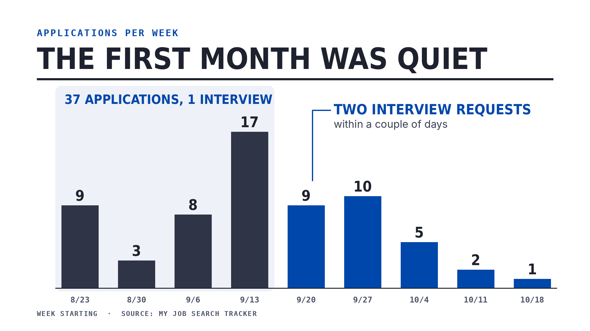
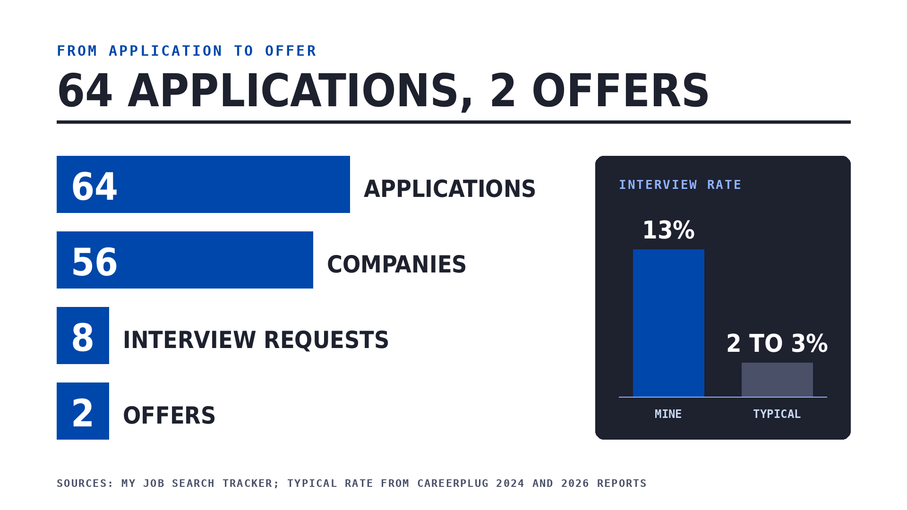

On August 20, my position was eliminated in a company restructuring. Today, a little over 11 weeks later, I start a new role as a Market Development Manager at Thermo Fisher. In between was a job search that was harder, weirder and more educational than I expected, and I tracked all of it in a spreadsheet (I'm a marketer, of course I did).

I wanted to write it down while it's still fresh, partly for me, and partly because when I was in the middle of it, hearing from people who'd actually gotten through it helped more than any headline.

## The first month

The first decision wasn't how to find a job, it was which job. For the last 18 months I'd been building process and workflow automation, and part of me wondered if that was the new career path. I decided to go back to what I do best, which is marketing. Conversations with friends and former colleagues helped me narrow it down: senior marketing roles at B2B companies with technical products, anywhere from product marketing to growth to digital marketing. I put "Senior B2B Marketing Professional" at the top of my resume and got to work.

I rebuilt my resume with AI (Gemini at first, then Claude), and somewhere in a pile of YouTube videos I found the Google XYZ formula: "Accomplished [X] as measured by [Y] by doing [Z]." I rewrote most of my bullets that way.

Things started fast. I had a hiring manager interview almost right away for a product marketing role at an advanced materials manufacturer. A dream role. And then I never heard back.

That was the first real hurdle. Rejection (and ghosting, which somehow feels worse) is hard not to take personally, and I had to put real effort into keeping my head in the right place. I gave my days a structure: mornings were for applying, always to jobs posted in the last 24 hours. Afternoons were for learning new skills, catching up on marketing trends, tightening my LinkedIn, resume and website, or taking the afternoon off for my own sanity.

About 10 days after I realized that first role wasn't happening, I stepped it up. In marketing terms, I was filling the pipeline.

A month in, I had 1 interview from 37 applications. That scared me. Reddit and the news kept saying how tough the market was, and LinkedIn was full of people six months in with hundreds of applications and nothing to show for it. My theory was that between AI and applicant tracking systems, a cold applicant just wasn't going to get seen, and my early numbers backed that up. I started (slowly) reaching out to my network and thought about being more active on LinkedIn, which honestly didn't feel like me.

Then two companies reached out for interviews within a couple of days of each other. Maybe my theory was wrong.

## Learning to interview

The two companies couldn't have been more different. One was huge, with lots of layers and business units, and I'd certainly be a cog in the machine (at this point in my career, that was welcoming). The other was a global industrial automation company with a very small US footprint, where I'd essentially be the marketing manager. Industrial automation wasn't where I was hoping to land, but I had 8+ years in it and knew I could succeed.

Here's what I had to admit to myself: interviewing was a weakness. I struggled to pull up the right past experience for a question, to say it clearly and briefly, and to tell a complete story that sounded professional. I knew that if I wanted to be considered, and to actually do well in these interviews, I had to turn that weakness into a strength. It's a skill, and it's one I'd barely used in my life. Like any other skill, I needed practice.

I started using Claude for mock interviews. I gave it my resume, raw dumps of my experience, the job description and the LinkedIn profiles of the people I'd be meeting. It asked the questions those interviewers would most likely ask, I dictated my answers back, and it gave me feedback and a suggested answer. It caught where I struggled, my filler words, and how I'd trail off at the end of answers, and we worked on exactly those things.

It also helped with something I didn't expect. I've accomplished a lot in my career, but recalling it on the spot was tough. Working through it with Claude brought back projects, campaigns and cross-functional work I'd half forgotten, and showed me how to use them for questions that only had a parallel to what I'd done.

Both companies moved me forward. One asked for a marketing plan and the other set up a panel interview. I was proud of the marketing plan, and it had a side benefit: it pushed me to learn how AI is changing marketing. I knew that whatever happened, the first thing I wanted to build was a content repurposing engine (which is how this post got made). The panel went incredibly well. I was ready for every question, and it gave me real confidence that I could do the job.

## Two offers and a decision

Then I got two offers. I was beyond excited. After 18 months out of marketing, it was validating to know I was still wanted for senior marketing roles. It also meant the search was over, and that was a relief.

The decision wasn't easy. I weighed the role and where it could lead, the people, the salary, the industry and the company, and each had its pros and cons. I chose Thermo Fisher for the industry, the people (I clicked with them in the interviews) and the room to grow. While researching the people I'd be meeting, I kept seeing the same thing: every one of them had been promoted multiple times. It's one thing for a company to say it believes in growing its people. It's another to see it on everyone's profile. I knew that if I worked hard and did well, it would be recognized.

I also had to tell the other company I wouldn't be joining. That was a hard conversation, because my interest had been genuine.

My start date was about 3.5 weeks after I accepted, and for the first time in a long time I had room to breathe. I rebuilt my website, started this blog, documented old projects, started (and finished!) new ones like my digital calendar frame, and got through apartment chores that were long overdue.

## By the numbers

Over about eight weeks of applying, I sent 64 applications to 56 companies. Eight of those companies asked me to interview, about 13% of applications. For comparison, a [2024 CareerPlug analysis of more than 10 million applications](https://jobgether.com/blog/why-senior-professionals-are-getting-fewer-interviews-in-2026) put the applicant to interview ratio at about 3%, and 2026 numbers look about the same.

A few more things from the spreadsheet:

- **84% of my applications came through LinkedIn.** About 9% were referrals, and none of those turned into an interview, which surprised me.
- **I sent 13 follow-up emails after interviews.** Two got a reply.
- **I had a salary number in mind going in**, and it lined up with the average of the posted ranges for these roles. Good to know I wasn't kidding myself.

And for the record, a few things I didn't do:

- I didn't tailor my resume with AI for every job description.
- I didn't change my title to match each job posting.
- I didn't reach out to hiring managers or HR to get noticed.

What I did do was make sure my resume read cleanly in applicant tracking systems. My test was simple: how much I had to fix when an application imported my resume. The less editing, the better it was being read.

A few things I noticed along the way. Open roles on LinkedIn had 100+ applicants within 4 days (remote roles even faster), yet the same roles got reposted again and again. Ghosting seems to be normal now, and I'd honestly love to hear from people in HR on why. And the application platforms themselves are clunky. Retyping your resume is one thing (a clean, ATS friendly resume cuts that way down), but the logins and notifications are cumbersome and don't do much.

## What I'd tell anyone searching right now

- **Know your story and how to tell it.**
- **Be ready for the tough questions.** A conflict with a coworker, a disagreement with your manager, a time you didn't succeed. Have real answers ready before someone asks.
- **"Tell me about yourself" is not your resume, condensed.** Pick 2 or 3 experiences and say why they make you a fit for this role.
- **Use the Google XYZ formula everywhere:** your resume, your "tell me about yourself," and how you talk about your work in general. The Y and Z are harder if you didn't own the whole project, but find the parts you did own and what impact they had, whether that's a metric, a savings, an improvement or feedback.
- **Use AI for mock interviews, and tell it to be critical.** Be honest with yourself about your weak spots. Constructive feedback is the whole point.
- **Apply on the company's site within 24 hours of a posting.**
- **Stay positive and confident.** It's easier said than done, but the rejections and the silence aren't a verdict on you.

If you're in the middle of it right now, I hope this helps a little, or at least shows it can turn around faster than the headlines make it sound.

---

*This post was produced with a Claude repurposing agentic workflow I built: I write down my raw thoughts, and AI helps turn them into this post, my social posts and the visuals. I review and edit everything before it goes live. Curious how it works? Ask me how I built it!*
